# Auri PMS

**Project Management System** &middot; *Plan. Track. Deliver.*

[](https://github.com/anoopverma-collab/Auri_PMS/actions/workflows/ci.yml)

A centralized platform for project planning, task management, timelines, effort tracking, team collaboration and delivery monitoring, built for **ERPNext v16**. Suitable for projects, tasks, milestones, timesheets, estimates versus actuals and management dashboards. Log, assign, track and close work items (bugs, features, tasks, support requests) against ERPNext Projects, plan them into sprints and releases, log time against them and report progress to clients. One screen to create an item, one list to work from, and no configuration beyond adding project members.

* Frappe v16 + ERPNext v16 (required app), standard Desk UI only, Frappe Cloud compatible
  (no OS packages, no custom bench commands at runtime).
* Module: **Tracking**. Nothing in Frappe or ERPNext core is modified: everything is added through
  hooks, Custom Fields, Custom DocPerms and `doc_events`.

## Features

| Area | What you get |
|---|---|
| Tickets (Work Items) | bugs, features, tasks and support requests with parent/child tickets, priorities, categories, start/due dates, estimates, relations and blockers; per-project ticket numbers such as `SJDM-00001` |
| Ticket Types and workflow | configurable ticket types with default status, *Counts as Defect* flag and allowed status transitions per project role |
| Project Hub | project-first screen: users only see projects they belong to (or public ones) and work inside the chosen project |
| Roles and access | project roles with nine capability flags; private projects stay hidden from outsiders |
| Sprints | start/end dates, goal, add tickets to a sprint, Start / Complete, Sprint Board and Burndown |
| Releases | group tickets into versions with progress and due date |
| Kanban board | one column per status, drag a ticket to change its status (blocked moves are refused) |
| Gantt chart | tickets drawn from start date to due date, filtered to the project |
| Time tracking | log hours per ticket with activity type and a *Billable* flag; limits per entry/day and lock days |
| Dependent on Client | tick a ticket that waits on the client; tracked with a note and *Waiting since* and counted everywhere |
| Dashboards | Project Health, Portfolio, My Work, Quality and Client Status Report |
| Themes and range | 8 themes in light and dark and a 1 month / 3 months / 6 months / Overall range, shared by all dashboards |
| Reports | Work Item Summary, Time Log Summary, Release Progress, Overdue Work Items, Sprint Summary, Sprint Burndown, Client Dependencies |
| Email | email a project's status report (preview, PDF, weekly schedule), daily due-date digests, optional email-to-ticket intake |

## Screenshots

All screenshots use the sample SJDM project data. Every dashboard shares one theme and one date range
(1 month, 3 months, 6 months or overall), set from the page menu. Tickets that wait on the client are
shown separately from tickets with us on every screen.

**Project Hub** is the starting point. It lists the projects you can access; opening one shows only that project's tickets, sprints, releases and time.

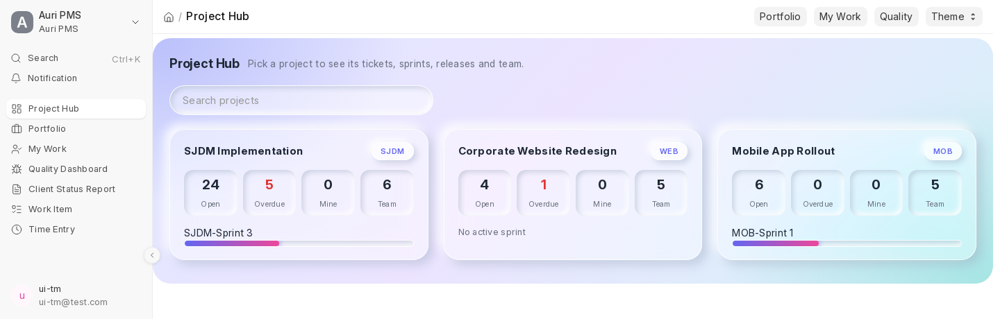

**Project overview** shows one project's ticket counts, the "Waiting on client" panel, active sprint and recent work.

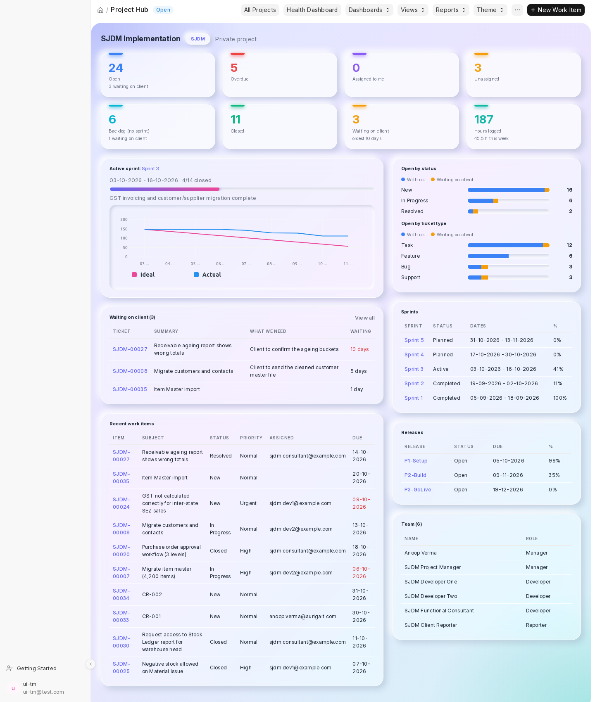

**Project Health** is the client-facing view: open vs closed, created vs resolved, spent vs billable hours, ageing, and open tickets split into with us and waiting on client.

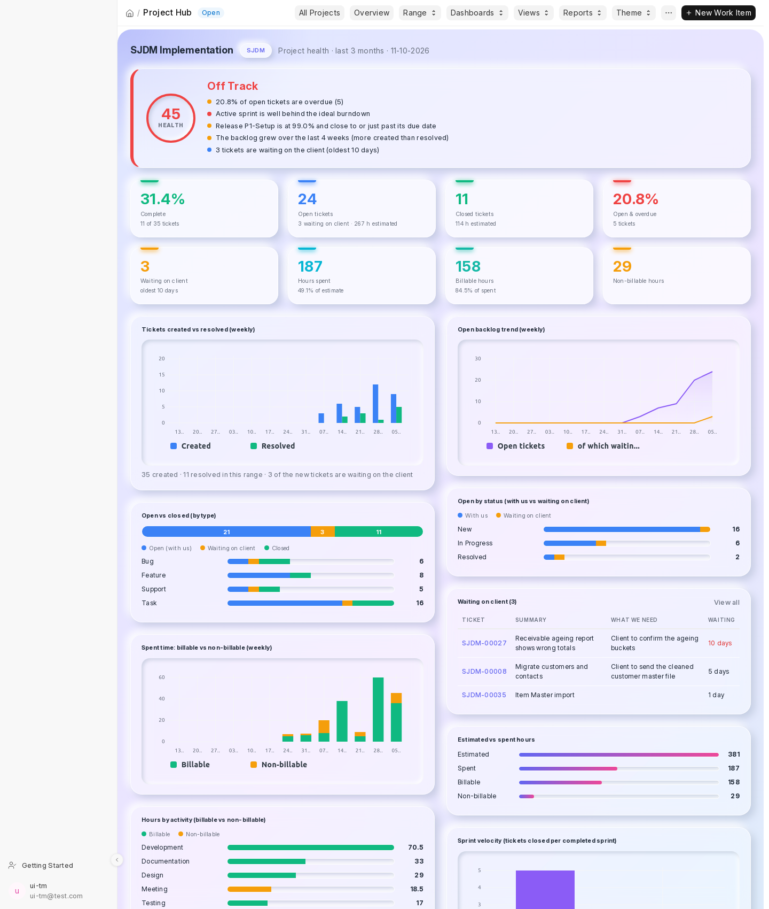

**Portfolio** compares every project you can see: health (On Track, At Risk, Off Track), overdue share, budget burn, billable share and client-waiting tickets.

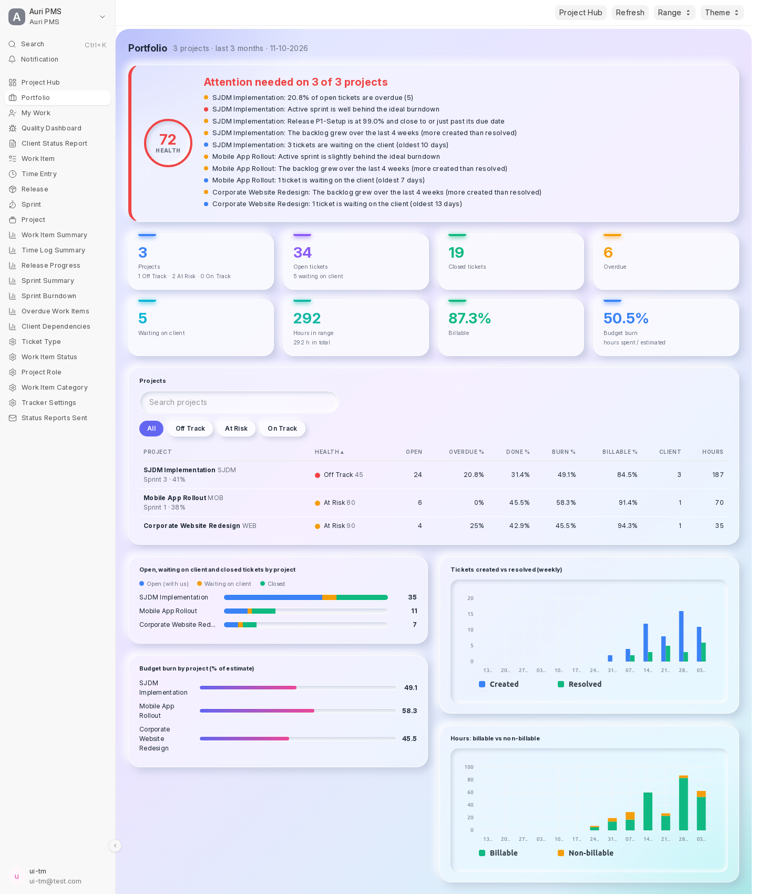

**My Work** is a personal page: your open tickets by due date, what blocks you, tickets waiting on the client, your hours this week and your sprints.

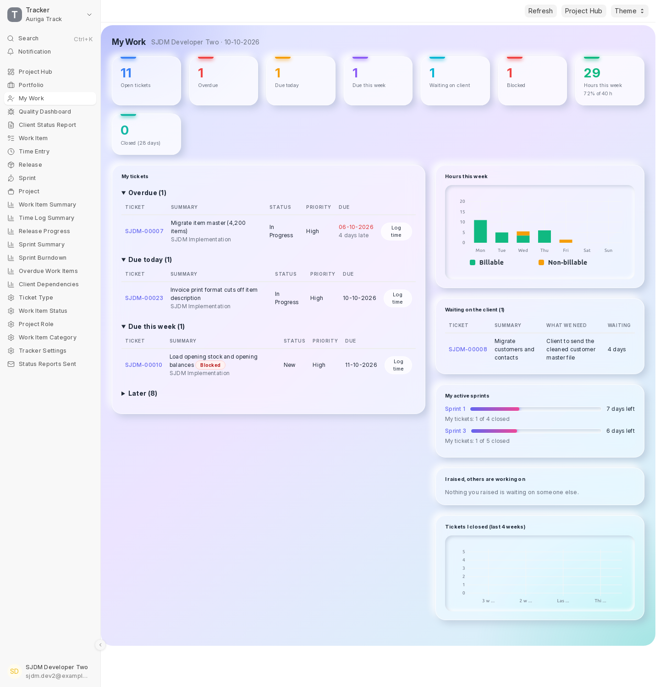

**Quality** tracks bugs: opened vs fixed, critical bugs, time to fix by priority, reopen rate and defects per 100 hours.

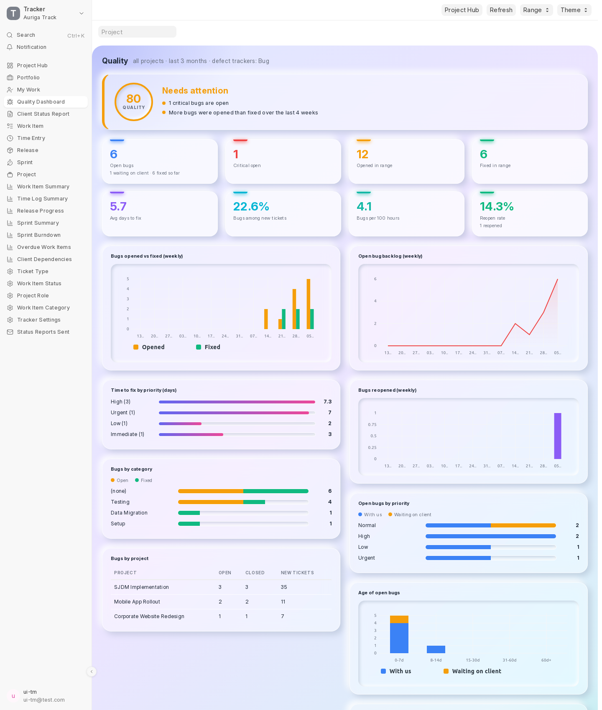

**Client Status Report** is a client-ready report for any period that can be emailed, downloaded as PDF or sent weekly.

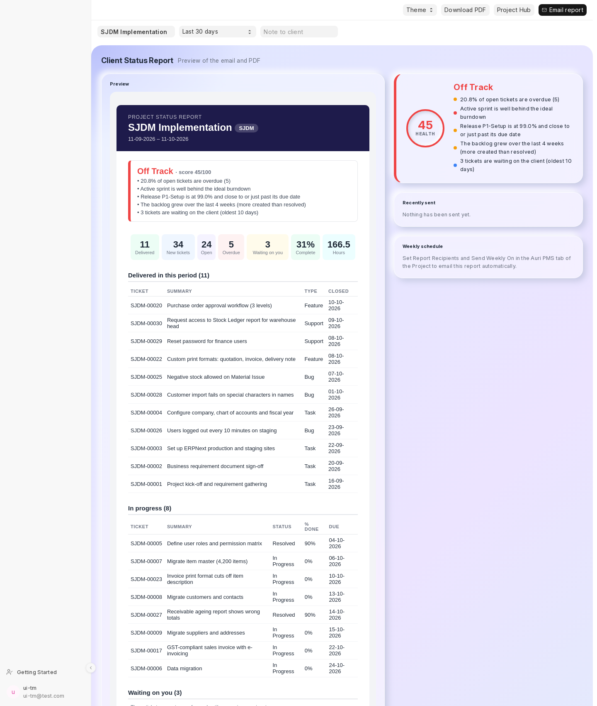

**Client Dependencies** is the drill-down report listing every open ticket waiting on the client, for how long and what is needed.

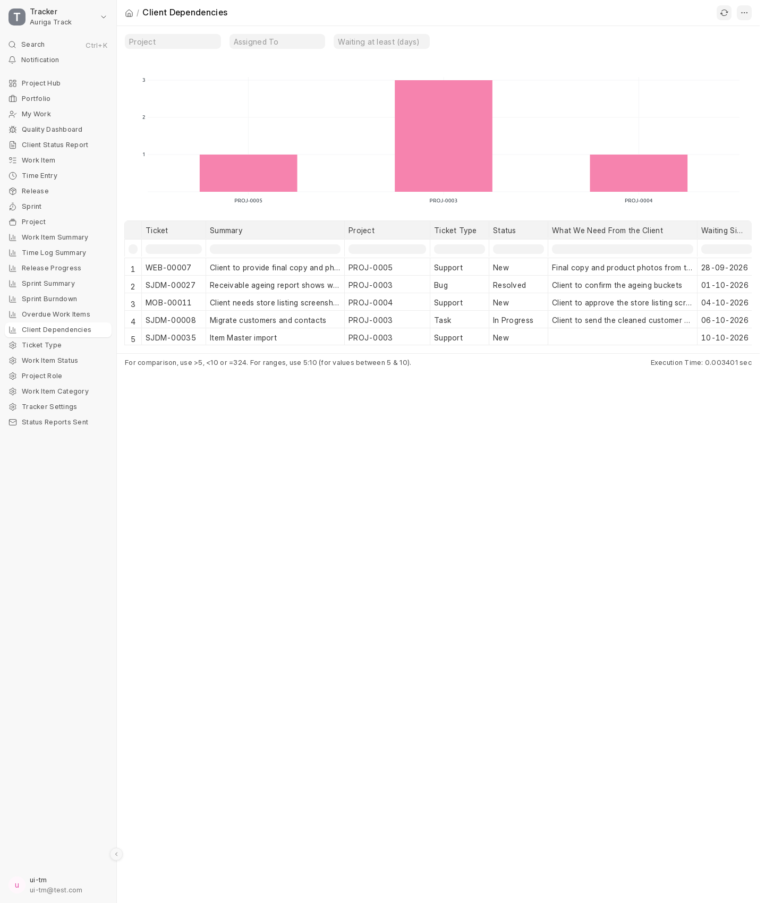

**Kanban board** has one column per ticket status. Drag a card to move the ticket; a move the workflow does not allow is refused. Open it from the hub's *Views* menu to see only that project.

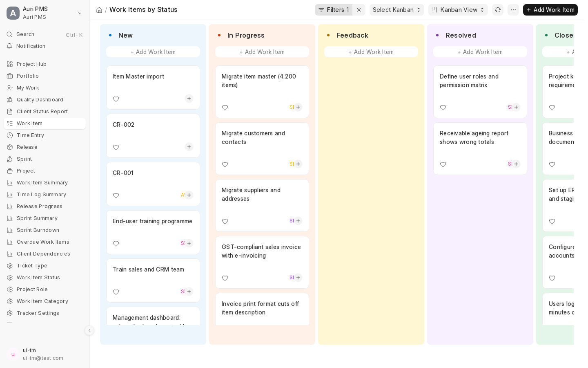

**Gantt chart** draws each ticket from its start date to its due date, so you can see overlaps and slips. Zoom with the Quarter Day, Day, Week, Month and Year buttons.


### Themes

Pick a theme from the *Theme* menu on any dashboard. It applies to all five dashboards, in light and dark, and is remembered per browser. There are eight: Glass + Soft, Soft UI (Neumorphism), Minimal Clean and Flat - Solid colour, plus four Soft UI variants that each add a surface effect:

| Theme | Effect | Best for |
|---|---|---|
| **Soft UI - Convex** | cards are slightly domed, with a light-to-dark gradient across the surface | a tactile, classic neumorphic look |
| **Soft UI - Pressed** | panels are sunk into the page like trays, while tiles stay raised | a calm, layered look |
| **Soft UI - Glow** | every tile glows in its own colour (blue, red, green...); strongest in dark mode | dark screens and wall displays |
| **Soft UI - Pearl** | glossy cards with a bright top edge and a soft sheen | a clean, polished look |

Every Soft UI theme has a matching dark version that follows Frappe's light/dark switch.

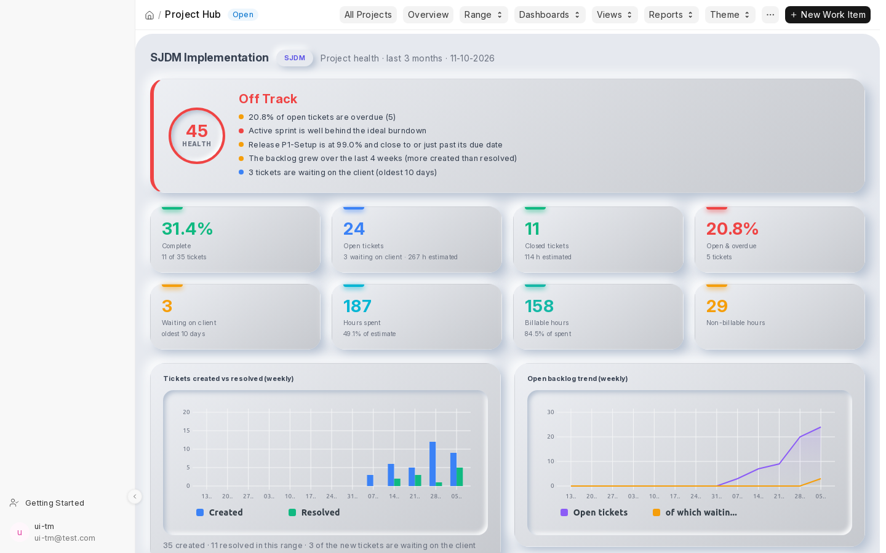
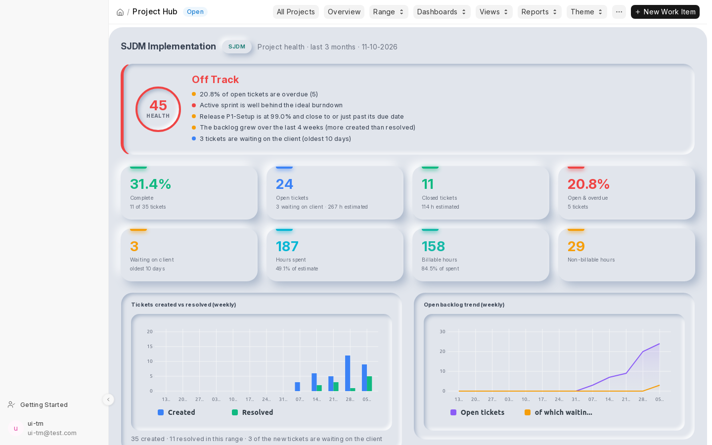
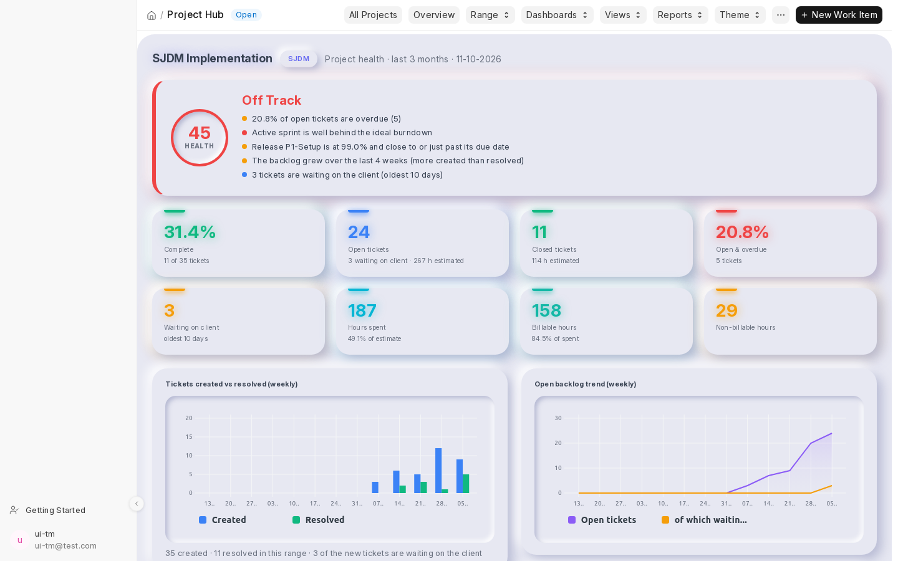
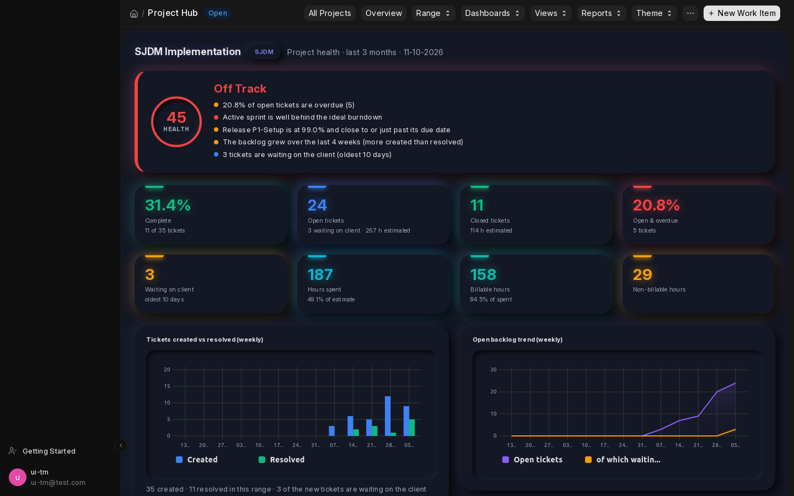
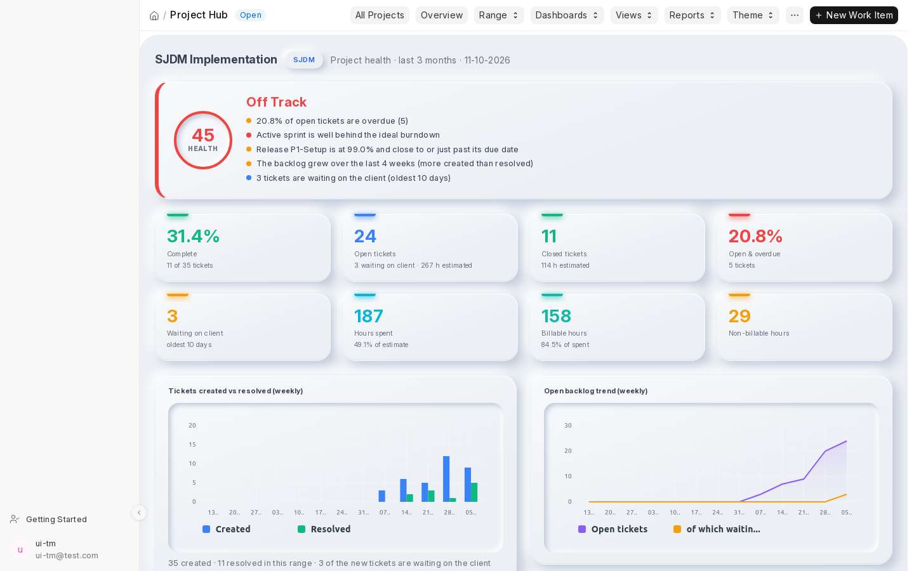

## Install

```bash
bench get-app https://github.com/anoopverma-collab/Auri_PMS
bench --site <site> install-app auri_pms
bench --site <site> migrate
```

`install-app` loads all fixtures (roles, custom fields on Project and Email Account, workspace,
number cards, charts, reports) and creates the default data **once**: 6 statuses, 3 project roles,
4 ticket types (Bug has a workflow), activity types, Tracker Settings and the Kanban board
"Work Items by Status". A later `migrate` never overwrites changes you made to that data.

Uninstall: `bench --site <site> uninstall-app auri_pms` (removes the Project and Email Account
custom fields, the Kanban board, the workspace and the Project permissions it added; ERPNext
Activity Types are left alone).

## Configuration

| Where | What |
|---|---|
| **Tracker Settings** | default status/priority, role used on public projects, close rules (children, blockers), time limits (per entry, per day, lock days), due reminder days, max subtask depth |
| **Work Item Status** | name, sequence, colour, *Is Closed*, default % done; a new status automatically becomes a Kanban column |
| **Ticket Type** | kind of ticket (Bug, Feature, Task, Support): default status, *Counts as Defect*, optional allowed-transition table per project role (empty = everything allowed) |
| **Project Role** | the nine capability flags (create/edit/delete items, manage releases/categories/members, log time, edit others' time, be assigned) |
| **Project > Auri PMS tab** | identifier (2-10 chars, set once), parent project, public flag, members + role, enabled ticket types | 
| **Project > Auri PMS tab > Health Status** | three checkboxes (all off by default) that show or hide the health status (On Track / At Risk / Off Track, score, reasons) on the Project Hub health dashboard, the Portfolio and the Client Status Report (email, PDF). Counts and charts are always shown |
| **Sprint** | project, name, start/end date, goal; status buttons Start / Complete Sprint; Sprint Board (Kanban) and Burndown |
| **Tracker Settings > Weekly Capacity** | working hours per person per week, used by My Work |
| **Email Account** | optional: *Tracker Project* (+ default ticket type) turns received mail into work items |

Roles: **Tracker Manager** (and System Manager) administer everything; **Tracker User** sees only the
projects they are a member of, plus public projects. Inside a project the member's **Project Role**
decides what they can do.

## 10-minute quick start

The app opens on the **Project Hub** (there is no home screen; the sidebar and the *Auri PMS* app icon start there). It lists the projects you are a member of (plus public ones). Open a project to see its tickets, overdue and unassigned counts, the active sprint with burndown, releases, team and time, and to create tickets, sprints and releases already scoped to that project. Views (list, board, Gantt, calendar) and reports open filtered to the project.

Dashboards (all share one theme choice, 8 themes in light and dark, and the *Range* menu: 1 month, 3 months, 6 months, Overall):

| Screen | For | What it shows |
|---|---|---|
| **Project Hub > Health Dashboard** | project manager, client | On Track / At Risk / Off Track with reasons, open vs closed, created vs resolved, backlog trend, sprint velocity, ticket aging, spent vs billable hours, tickets waiting on the client |
| **Portfolio** | management | a status banner like the other dashboards (worst health, average score and the projects that need attention, for projects with the Portfolio switch ticked) and one row per project: health, open, overdue %, done %, budget burn, billable %, tickets waiting on the client; ticket, budget, flow and hour charts |
| **My Work** | everyone | my tickets by due date (overdue / today / this week / later), blocked and client-waiting badges, my sprints, hours this week against the weekly capacity, one-click *Log time* |
| **Quality Dashboard** | QA, project manager | bugs opened vs fixed, critical bugs, time to fix by priority, reopen rate, defects per 100 hours, bugs by category and project (ticket types marked *Counts as Defect*) |
| **Client Dependencies** (report) | project manager | every open ticket waiting on the client, how long, and what is needed; opened from the *Waiting on client* tiles |
| **Client Status Report** | project manager | a client-ready report for any period: status, delivered, in progress, coming up, risks, *Waiting on you*, plan and hours; email it (logged as *Project Status Report*), download a PDF, or let it go out weekly (Project > Auri PMS tab: *Report Recipients*, *Send Weekly On*) |

Tick **Dependent on Client** on a ticket (and say what you need): it records *Waiting since*, shows a banner on the ticket and is counted live in the hub, health dashboard, portfolio, My Work and the client report (where the ticket is listed under *Waiting on you*). Tickets waiting on the client are not counted as delivery delays in the project's status.

A daily scheduler job emails each assignee one digest of items that are due within the reminder window
or overdue.

## Development

```bash
bench --site <site> run-tests --app auri_pms          # whole suite
bench --site <site> run-tests --app auri_pms --module auri_pms.tracking.tests.test_workflow
ruff check . && ruff format --check .                      # Python
eslint --ext .js auri_pms                              # JS (default Frappe config)
```

Tests live in `auri_pms/tracking/tests/`, one file per area (215 tests at the time of writing); `utils.py` builds the shared fixture world once per class and isolates every test with a
database savepoint. Business rules live in the DocType controllers and `tracking/utils.py`; client
scripts are UX only.

Design decisions made where the specification was silent are listed in [DECISIONS.md](DECISIONS.md).

## Layout

```
auri_pms/
  hooks.py  install.py  permissions.py  patches/
  fixtures/                 custom fields, roles
  public/js/                auri_hub.bundle.js (shared dashboard UI and themes), auri_pms.bundle.js, project.js
  workspace_sidebar/  desktop_icon/
  tracking/
    utils.py                capabilities, hierarchy, roll-ups, progress formula
    api.py                  hub, health, portfolio, My Work and quality endpoints, log_time, link queries
    health.py  dashboards.py  status_report.py
    email_intake.py  tasks.py  project_hooks.py
    doctype/                Work Item, Sprint, Release, Time Entry, Ticket Type, Project Role, ...
    page/                   project_hub, portfolio, my_work, quality_dashboard, status_report
    report/                 work item, time log, release, sprint and client dependency reports
    tests/
```
